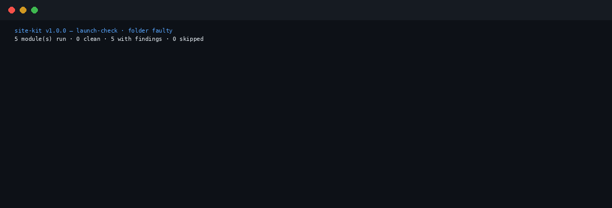

<h1 align="center">site-kit</h1>

<p align="center"><strong>Is this site ready to launch? The audit, the legal pages, the widgets, the link page and the testimonials wall — checked together, in one local run.</strong></p>

<p align="center">
  
  
  
  
  
</p>

<p align="center"></p>

Launching a small static site is one job seen from
five sides. The pages need a pre-launch audit (titles,
meta, alt text, links that resolve). The legal pages
have to exist — privacy, terms, cookies, a consent
banner — and they have to say only what is actually
true of the business. Then the boring widgets every
site re-buys as subscriptions: an FAQ, pricing, a
countdown, social proof. A link-in-bio page. A
testimonials wall. Five tools used to do these five
jobs separately, and nobody installs five tools for
one launch.

site-kit is the five as one suite. Each module keeps
its source tool's checks, generators, verdict words
and honesty limits — the engines are ported
byte-identical, not rewritten — and a combined
`launch-check` runs every module over a single site
folder and prints one launch-readiness receipt:
per-module verdicts, the exact findings, and one
READY / NOT READY line. No LLM. No network. Nothing
uploaded; site data never leaves the machine.

**What a verdict means — read this first.** A PASS or
a READY means the folder satisfies the checks
*encoded in these modules* — never that the site is
legally compliant or that any platform will accept
it. The legal pages are templates generated from the
facts a profile states; they are **not legal advice**.

## The receipt family

One grammar — *claims on one side, evidence on the
other, every verdict cited* — across the fleet:

- **[skill-vet](https://github.com/jasveerai88/skill-vet)
  — is it dangerous?** Vets agent skills for stealing,
  spying and hidden sending before you install them.
- **[permission-audit](https://github.com/jasveerai88/permission-audit)
  — what can the agent actually do?** Audits Claude
  Code permission rules against the documented
  deny → ask → allow semantics.
- **[done-claim-auditor](https://github.com/jasveerai88/done-claim-auditor)
  — did the agent do what it claimed?** Audits session
  transcripts for done-claims the evidence contradicts.
- **[skill-claims](https://github.com/jasveerai88/skill-claims)
  — is the package honest?** Checks an agent skill's
  prose promises against its static behaviour.
- **[spec-receipt](https://github.com/jasveerai88/spec-receipt)
  — does the code still match the spec?** Per-item
  drift verdicts between a Markdown spec and the code's
  declared surfaces.
- **[preflight-agent](https://github.com/jasveerai88/preflight-agent)
  — is the agent setup safe to run?** Five setup checks
  (clone-guard, secret-guard, hook-doctor, fleet-audit,
  skill-sprawl) as one scan.
- **[charity-compliance](https://github.com/jasveerai88/charity-compliance)
  — is this charity ready to file?** Donation receipts
  and the T3010 return as one filing-readiness check.
- **site-kit — is this site ready to launch?** The
  family's static-site member: the same discipline
  pointed at a deploy folder instead of a codebase, a
  charity's books or an agent's setup.

Two more fleet members run the same play on their own
ground: **[faceless-qc-lite](https://github.com/jasveerai88/faceless-qc-lite)**
— is this video ready to upload? — the pre-upload QC
suite for faceless video channels, and
**[gst-hst-tracker](https://github.com/jasveerai88/gst-hst-tracker)**
— quarterly GST/HST set-aside and the $30,000
small-supplier threshold for Canadian sole proprietors.

## Quick start

```bash
pipx install site-kit        # or: pip install site-kit
site-kit launch-check path/to/site-folder
```

*(Live on PyPI since v1.0.0. Source checkouts also work: `pip install .`, or
`pipx install git+https://github.com/jasveerai88/site-kit`.)*

Or each module on its own:

```bash
site-kit site-audit audit SITE_DIR [--json]
site-kit compliance-pages check --profile PROFILE.json [--as-of YYYY-MM-DD] [--json]
site-kit compliance-pages make --profile PROFILE.json --out DIR [--json]
site-kit widget-kit make --config CONFIG.json --out DIR [--json]
site-kit link-page-kit preview CONFIG.json [--json]
site-kit link-page-kit build CONFIG.json [-o index.html] [--json]
site-kit wall-of-love preview TESTIMONIALS.json [--json]
site-kit wall-of-love build TESTIMONIALS.json [-o wall.html] [--json]
```

Pure Python 3.10+ standard library. Local only, no
network. Exit codes everywhere: **0** pass, **1**
findings, **2** usage or input error. Every command
accepts `--json` and prints exactly one JSON object.

From a source checkout, the fixture builder in
`examples/` builds one fictional small-business site
(Exampleton Trail Gear) two ways — a clean folder and
a faulty one with exactly one planted fault per
module:

```bash
python3 examples/make_fixture.py faulty
site-kit launch-check faulty --as-of 2026-04-01   # exit 1 — NOT READY
python3 examples/make_fixture.py clean --clean
site-kit launch-check clean --as-of 2026-04-01    # exit 0 — READY
```

(`--as-of` pins the generation date compliance-pages
prints on its check, so the receipt is reproducible.)

## The modules

| Command | Question it answers | Verdict words |
|---|---|---|
| `site-audit` | Does the deploy folder pass the pre-launch audit? | PASS / FAIL — errors block; warnings and info are labelled judgement calls |
| `compliance-pages` | Does the profile state every fact the legal pages need? | COMPLETE / INCOMPLETE, with each gap named as the `[TO FILL: ...]` placeholder it would ship as |
| `widget-kit` | Does the widgets config render clean? | The fragments it wrote, plus a warning for every defect the render exposes |
| `link-page-kit` | Is the link-page config structurally sound? | Checks passed, listed one by one; warnings for duplicates and defects |
| `wall-of-love` | Is the testimonials file sound? | Checks passed, listed one by one; warnings for duplicates and defects |
| `launch-check` | Is this site — all five sides together — ready to launch? | READY / NOT READY, one receipt over every module; a module with no input is SKIPPED with the reason, never passed |

**site-audit** — titles, meta, headings, alt text,
internal-link resolution, JSON-LD validity, sitemap
and robots, as a prioritised plain-language fix list.
Internal references are checked against the folder on
disk; external links are never fetched.

**compliance-pages** — privacy, terms and cookie
pages plus a self-hosted consent banner, generated
from one site-profile JSON. Templates state only the
facts the profile gives them; anything unstated ships
as a loud `[TO FILL: ...]` placeholder, never as an
invented fact. `check` reports the gaps without
generating anything; `make` writes the pages.

**widget-kit** — the four boring widgets as static
fragments you own: FAQ (with JSON-LD generated from
the same items), pricing, countdown, social proof.
No view metering, no third-party script phoning home.

**link-page-kit** — one config file in, one
self-contained link page out: a Linktree replacement
with no trackers, no monthly fee and no lock-in.
Dangerous URLs are refused; the page references only
your own links.

**wall-of-love** — a testimonials file in, one
self-contained wall page out, with schema.org JSON-LD
generated from the same data as the wall — the
aggregate and the count cannot drift.

**launch-check** discovers each module's input in the
folder (deterministically, recursive in sorted order,
`.git` never entered, extension matching
case-insensitive) and runs the module's read-only
mode:

| Module | Input it discovers | Combined-run mode |
|---|---|---|
| site-audit | the folder itself, when it holds `.html`/`.htm` pages | `audit` |
| compliance-pages | a `.json` with a `business` object and a `pages` list naming privacy/terms/cookies | `check` (never `make`) |
| widget-kit | a `.json` with a `widgets` list | `make`, trial-rendered into a fixed-name temporary folder that is removed when the run ends |
| link-page-kit | a `.json` with a `name` and a `links` list | `preview` (never `build`) |
| wall-of-love | a `.json` with a `testimonials` list, else a `.csv` whose header names `name` and `quote` | `preview` |

One file serves at most one module. A module with no
discoverable input reports **SKIPPED** with the
reason — skipped is never counted as passed. READY
requires at least one module to have run and every
module that ran to be clean; an empty folder is NOT
READY. The run writes nothing into the folder it
checks.

## The receipt

The faulty fixture plants exactly one fault per
module: a page whose `<title>` was removed; a legal
profile with its `retention` fact deleted; a countdown
aimed at 2020-01-01; a link list with its first link
duplicated at the end; a testimonials file where two
people carry the same quote verbatim. This is the
complete, unedited output of
`site-kit launch-check faulty --as-of 2026-04-01`
(exit 1):

```text
site-kit v1.0.0 — launch-check · folder faulty
5 module(s) run · 0 clean · 5 with findings · 0 skipped

===== site-audit — the deploy folder vs the pre-launch audit checks =====
site-audit v0.1.0 — audit · folder faulty
1 page(s) · sitemap.xml present · robots.txt present
Local only: internal references are checked against the folder on disk; external links are never fetched.

ERRORS — fix before launch (1):
[title-missing] index.html — the page has no <title> (or it is empty) — browsers and search results will show the URL instead
  fix: add a <title> in the <head> naming this page

Per-page summary (counts only):
  index.html — 1 error(s) · 0 warning(s) · 0 info

Summary: 1 finding(s) · 1 error(s) · 0 warning(s) · 0 info across 1 page(s)
Verdict: FAIL — 1 error(s) to fix before launch.

===== compliance-pages — the site profile vs the facts the legal pages need =====
compliance-pages v0.1.0 — check · profile profile.json
Variant: canada · pages make would generate: privacy, terms, cookies (+ consent.js, banner.html, manifest.txt always)
Generation date: 2026-04-01

GAPS — facts the documents need that the profile does not state (1):
  - retention → [TO FILL: how long collected information is kept]

Verdict: INCOMPLETE — fill the gaps above in the profile; anything left unstated ships as a loud [TO FILL: ...] placeholder, never as an invented fact.

===== widget-kit — the widgets config, validated by a trial render =====
widget-kit v0.1.0 — make · config widgets.json
Wrote 1 fragment(s) into /tmp/site-kit-launch-check/widgets:
  sale.html — 772 bytes · countdown · target 1 Jan 2020, 00:00 (UTC-08:00)
Warnings:
  ! widgets[0] (countdown): countdown target '2020-01-01T00:00:00-08:00' is already in the past — the fragment will show its ended_text
(fragments above were trial-rendered into a temporary directory and discarded — nothing was written into this folder)

===== link-page-kit — the link-page config vs the structural checks =====
link-page-kit v0.1.0 — preview · config links.json
Maya Chen · 7 link(s), 2 social(s) · page weight 3,267 bytes

Links, in order:
  1. Watch on YouTube — https://youtube.com/@KelownaTrailcast — New video every Friday
  2. Follow on Instagram — https://instagram.com/kelownatrailcast
  3. Trailcast stickers — my shop — https://example.org/shop/stickers — Ships within Canada
  4. Listen to the podcast — https://example.org/trailcast
  5. Trail conditions map — https://example.org/trail-conditions
  6. Email me — mailto:maya@example.org — Sponsorships and ride invites
  7. Watch on YouTube — https://youtube.com/@KelownaTrailcast — New video every Friday

Socials:
  1. TikTok — https://tiktok.com/@kelownatrailcast
  2. X — https://x.com/kelownatrailcast

Checks passed:
  ✓ name present
  ✓ 7 link(s), every label present
  ✓ every URL uses an allowed scheme (https, http, mailto, tel)
  ✓ single file, no external requests besides the configured links, socials and avatar
  ✓ avatar is referenced, not embedded
  ✓ accent colour is a valid hex value
Warnings:
  ! duplicate URL: 'https://youtube.com/@KelownaTrailcast' (links[6] 'Watch on YouTube') is the same target as links[0] 'Watch on YouTube'

===== wall-of-love — the testimonials file vs the wall checks =====
wall-of-love v0.1.0 — preview · file testimonials.json
Exampleton Trail Gear · 2 testimonial(s) · page weight 3,321 bytes
Aggregate: 4.5 out of 5 from 2 rated testimonial(s) · review count 2

Testimonials, in display order (rating, then newest):
  1. Ana Ruiz — ★★★★★
  2. Ben Osei — ★★★★☆

Checks passed:
  ✓ 2 testimonial(s), every name and quote present
  ✓ every rating present is an integer from 1 to 5
  ✓ single file, no external requests besides the configured logo, avatars and source links
  ✓ JSON-LD generated from the same data as the wall — aggregate and count cannot drift
  ✓ aggregate 4.5 from 2 rated testimonial(s)
Warnings:
  ! duplicate quote: testimonials[1] ('Ben Osei') repeats testimonials[0] verbatim — the wall shows what the file holds, but a repeated quote reads as padding

VERDICT: NOT READY — findings in site-audit, compliance-pages, widget-kit, link-page-kit, wall-of-love — fix each module's section above before launch.

site-kit is a local checking and generation aid. launch-check writes nothing into the folder it checks (widget fragments are trial-rendered into a temporary directory and discarded). A READY verdict means every module that ran reported clean under its own rules — never that the site is legally compliant or will pass any platform or app-store review. compliance-pages generates templates from the facts a profile states; they are not legal advice — have them reviewed before relying on them.
```

The clean folder, same command (exit 0):

```text
site-kit v1.0.0 — launch-check · folder clean
5 module(s) run · 5 clean · 0 with findings · 0 skipped
[...]
VERDICT: READY — every module that ran was clean (site-audit, compliance-pages, widget-kit, link-page-kit, wall-of-love). READY covers only the modules' own checks — it is never a statement of legal compliance or platform acceptance.
```

## Contracts

- Every command accepts `--json` and prints exactly one
  JSON object. Module commands emit exactly the object
  their standalone tool emits; `launch-check` emits one
  combined object whose per-module sections are the
  modules' own objects plus their `exit_code` (skipped
  modules carry `status`, `reason`, `clean: null`).
- Exit codes everywhere: **0** pass, **1** findings,
  **2** usage or input error. Errors — argparse
  included — are `{"error": "..."}` in `--json` mode.
  Never a traceback.
- Read-only where it matters: `launch-check` writes
  nothing into the folder it checks, and site data
  never leaves the machine. The generators write only
  where their own `--out` / `-o` points, and only when
  you run them directly.

## Why this suite exists — the merge

site-kit is flagship B4 of the fleet audit
(FLEET-AUDIT-2026-11-04), which ordered 18 quiet tools
merged into 4 flagships — and it is the last of the
four. site-audit, compliance-pages, widget-kit,
link-page-kit and wall-of-love were each shipped,
tested tools, but they are five sides of one job, and
nobody was installing all five to answer "are we ready
to launch?" The engines are ported **byte-identical**
to their sources — no check, generator, verdict word
or honesty limit changed; each module still reports
its own v0.1.0 inside its sections. What is new is
only the dispatcher and the combined run, plus two
dispatcher-side lessons from stage 1, both about
determinism: widget-kit's trial render first used a
random temporary path, which leaked into its own
reported output directory and made repeat receipts
differ — it now renders into a fixed-name temporary
folder, removed when the run ends — and claim-tracking
ensures one discovered file serves at most one module,
so a config can never be silently double-counted.

One behaviour was observed in stage 1 and deliberately
**not** changed: compliance-pages' `check` treats
`--as-of` as a reported value and never parses it (only
`make` validates the date). That is the engine's own
source behaviour; engines are ported, not improved.

## Tests

```bash
python3 -m unittest discover -s tests
```

324 tests: the five source suites ported (71 + 34 +
48 + 62 + 76 = 291; the only edit is each suite's
examples paths, since examples now live per-module
under `examples/<module>/`) plus 33 dispatcher /
launch-check tests covering routing, the JSON/error
contract, discovery, skip honesty, the planted-fault
fixture (one fault per module, each asserted exactly),
read-only behaviour and byte-identical repeat runs. All
pass on a clean checkout — including in a copy with
every executable bit stripped (the suites drive the
engines through the Python interpreter).

## Honest limits

- **A checking and generation aid, not legal advice.**
  READY is a statement about the modules' own checks
  only — not legal compliance, not platform or
  app-store acceptance. Have generated legal pages
  reviewed before relying on them.
- The audit reads static `.html`/`.htm` files on disk;
  it says nothing about server behaviour, and external
  links are never fetched — link checks are structural,
  never liveness.
- The legal templates state only the facts a profile
  gives them. A profile that omits a fact produces a
  loud `[TO FILL: ...]` placeholder, not an invention —
  but filling placeholders in is a human's job, and a
  COMPLETE verdict means the profile was complete, not
  that its facts are true.
- The wall shows what the testimonials file holds.
  Nothing here verifies that a testimonial is genuine;
  a fabricated review in the input becomes a fabricated
  review on the wall. The JSON-LD aggregate is computed
  from the same data, so it cannot drift from the wall —
  it also cannot make the data honest.
- Generators write only where their own `--out` / `-o`
  points. `launch-check` never writes into the folder
  it checks; widget fragments inside it are
  trial-rendered into a temporary folder and discarded.

## Contributing & security

See CONTRIBUTING.md (stdlib only, engines ported not
rewritten, skipped is not clean) and SECURITY.md
(private vulnerability reporting; the suite is
local-only, and its combined run is read-only by
design).

## Support

If this suite saved you a launch-day surprise,
sponsoring keeps the receipt family maintained:
https://github.com/sponsors/jasveerai88

## License

MIT — see LICENSE.
